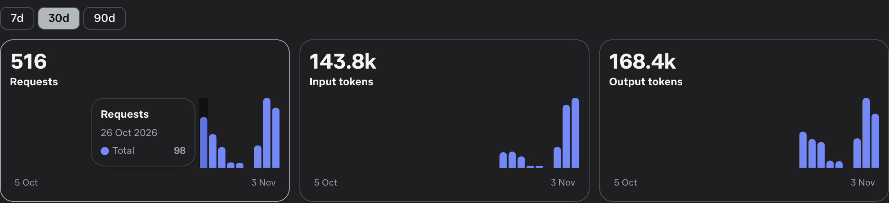
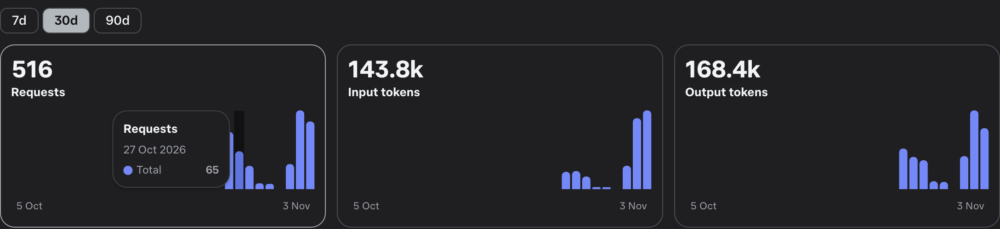
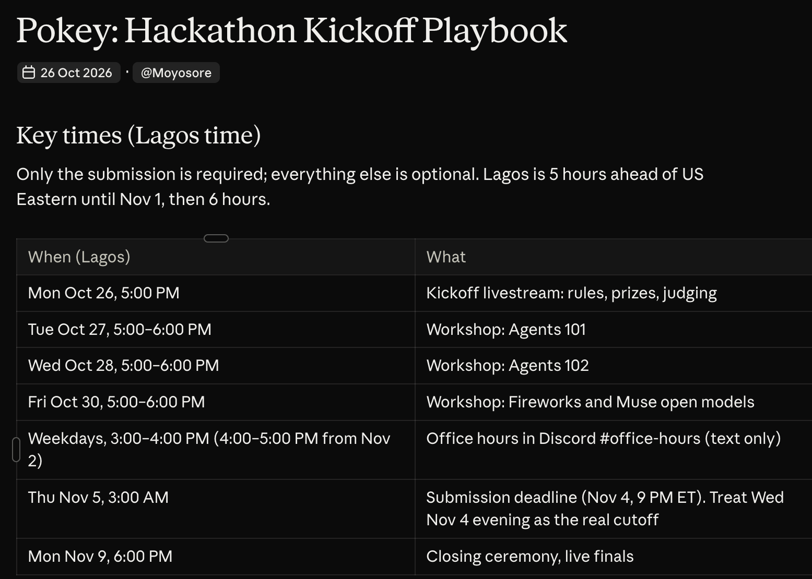

# Nudged

**Nudged is the reminder app that nudges back.** Say or type everything on your mind: Muse Spark turns it into reminders, asks follow-up questions, and Nudged nudges you until it's done, with lines from the open-weights Muse Spark Open on Baseten or Modal. Voice by Muse Voice Transcribe, photo proof checked by SAM 3.1, personal badges drawn by Muse Image from art direction by Muse Wonder.

Dump everything on your mind, messy, by voice or text. Nudged turns it into tidy reminders, then nudges you, cheekily and with escalating drama, until each one is done.

Live at [getnudged.chat](https://getnudged.chat). Problem statement: **Build for Your World**. It's for anyone who forgets things when busy and won't organise themselves first, so a reminder app has to do the organising and the chasing.

Everything in this repo was built from scratch for the Meta Global AI Developer Hackathon, Oct 26 – Nov 4, 2026. It was called Pokey and then Nudgy during the build, so older commits and notes use those names, and the repo link still says nudgy. The first commit is project setup only, made on Oct 26 after the kickoff session; features start on Oct 27. [NOTES.md](NOTES.md) and the commit history record each feature as it was built.

## Built during the hackathon

Built by James Moyosore, using Claude Code as a coding assistant. All the AI inside the app runs on Meta's models.

Check it yourself, no login needed:

- **Live app:** [getnudged.chat](https://getnudged.chat)
- **Source code:** [github.com/moyocodes/nudgy](https://github.com/moyocodes/nudgy)
- **Every commit, with dates:** [commit history](https://github.com/moyocodes/nudgy/commits/main)
- **First commit, project setup on Oct 26:** [a4925ee](https://github.com/moyocodes/nudgy/commit/a4925eead997cdc13356f883ac847728c538d7d7)
- **First full version of the app, Oct 27:** [3629b5b](https://github.com/moyocodes/nudgy/commit/3629b5bd31a0a52b4976f32b8d53009c43a8d791)
- **What was built, feature by feature:** [NOTES.md](https://github.com/moyocodes/nudgy/blob/main/NOTES.md)

Meta Model API usage from the project's dashboard, which is private, so these are screenshots. The 30-day view shows requests on the first two days: 98 on Oct 26 and 65 on Oct 27.




The plan written on kickoff day, dated Oct 26, when the app was still called Pokey:



## What it does

- **Messy in, tidy out.** "ugh dentist?? oat milk. yinka's tmrw like 5pm" becomes three reminders with times. Muse Spark fixes typos and mishearings, works out dates, priorities and repeats ("every weekday at 8"), and asks a short, punny question when something essential is missing.
- **It knows your list.** "I called mum", "move the gym to 7" or "cancel the dentist" act on the existing reminder instead of adding a duplicate. Tap **@** on a reminder to give it instructions directly. "Undo" reverses the last change.
- **Nudges until it's done.** Due reminders get a fresh, model-written line, escalating from Nudge to Shove, until you tap Done or Snooze for 30 min, 1 hour or 90 min (snoozing is free). An overdue reminder has its Done and Snooze buttons on Today as soon as you open the app. During sleep hours only high-priority reminders nudge. Nudges show as browser notifications when the tab is in the background.
- **Emails when you're away.** A reminder emails you when due, then at gaps of 30, 60, 120 and 240 minutes, with no model call. Nothing goes out during sleep hours, and one morning email lists the day's reminders.
- **Choose the model, see the model.** A switch beside the mic, and on the Me page, picks who answers: Muse Spark Open on Baseten, Muse Spark Open on Modal, or Muse Spark on Meta. On Auto, each call takes the next one in turn. A tag stays on screen naming the model and host behind the latest call, and each nudge shows its own.
- **It remembers the conversation.** Nudged reads your last 30 dated messages, saved to your account, so a new visit or another device carries on where you left off.
- **It notices an unfinished thought.** Stop typing or talking for 15 seconds with something unsent, and Nudged sends one line nudging you to finish it. Once a reminder is set, the conversation is over.
- **Work carries on without you.** Brain dumps, Plan my day and badges finish on the server if you reload or lose connection. The app collects the result when you're back, and shows the model still working until then.
- **Plan my day.** One tap and an agent works through your list: it checks your day, moves overdue reminders to free times and spreads out clashes. The server refuses past, sleep-hour and clashing times, so it has to try again. Each step shows on screen, and Undo reverses the run.
- **Daily goals.** Recurring reminders show as a checklist on Today. A missed day is skipped instead of piling up as overdue.
- **Pics or it didn't happen.** Every reminder asks for photo proof, which earns +15 points with a photo that passes the check, or can be skipped for the normal points. SAM 3.1 looks first; if it says no, Muse Spark looks at the photo before Nudged rejects it, so a photo of a bank counts as "bank" while a photo of a parrot doesn't.
- **Rewards.** Points, a daily streak and badges, with personal badge art directed by Muse Wonder and drawn by Muse Image. While it draws, a loader made from Muse Image frames plays.
- **Restyle Nudged.** Describe a look on the Me page. Muse Wonder writes the art direction, Muse Image draws it, the background is cut away, and that Nudged appears across the app and follows your account. A button brings the original back.
- **Its own voice.** A voice picker on the Me page lists the voices on your device, nicest first. A chime plays on every nudge.
- **Every device.** Log in with just your email, and tasks, chat, points, streak and pictures sync. For the hackathon demo there is no emailed code, so judges can get straight in; a new device gets a login email, and `REQUIRE_SIGNUP_CODE` and `REQUIRE_LOGIN_CODE` turn codes back on.
- **Four personalities.** Chill, Cheeky, Sassy and Night owl themes, each with its own font, look and colour choices.

Nudged is always warm and cheeky, and a nudge makes sense on first read. Never flirty, never mean, never medical.

## How the AI is used

| Feature | Model | Call happens when |
|---|---|---|
| Voice brain-dump | Muse Voice Transcribe (live, streamed through the server) | You tap the mic |
| Turning a dump into reminders and actions, with chat memory | Muse Spark Open on Baseten or Modal, or Muse Spark on Meta, by the switch or Auto, with Muse Spark as backup | You press Add tasks / Enter |
| Nudge lines | The same choice of models and backup | A nudge is actually due, or you tap Nudge me or Try a nudge |
| Quiet check-ins | The same choice of models and backup | 15 seconds of quiet with something typed or said but not sent |
| Photo brain dump | Muse Spark reads a handwritten list, flyer, notice or screenshot in the same call as any message, and words in a picture can only add reminders | You add a photo or screenshot beside the mic |
| Photo proof | SAM 3.1 finds the task's object in your photo, then Muse Spark takes a second look if SAM says no | You send a proof photo |
| Plan my day | Muse Wonder as an agent, one tool per step, at most 5 calls | You tap Plan it |
| Personal badge art | Muse Wonder writes the art prompt, Muse Image draws it | You tap Create my badge |
| Restyle Nudged | Muse Wonder writes the art prompt, Muse Image draws it | You tap Draw my new look |

Model output is never trusted blindly. The server drops tasks with no title, turns an unreadable time into a "when?" question, ignores actions that point at reminders that don't exist, and Nudged's confirmation ("Set: Call mum, today 6 PM") is built from what was really saved, so it can't claim a reminder it didn't make. If a call fails, a local parser and canned nudges keep the app working.

## Tech

- **Frontend:** React 19, Vite, Tailwind CSS v4, Framer Motion and GSAP for motion.
- **Backend:** Express, with the OpenAI SDK pointed at the Meta Model API (`https://api.meta.ai/v1`), Baseten and Modal, and a WebSocket relay for live transcription. Long calls keep their result under a job id for an hour, so the app can collect it after an interruption.
- **The API key stays on the server.** Vite proxies `/api` to Express, so the browser never sees it.
- **Accounts:** passwordless email login, with email sent through Resend. The session is an HTTP-only cookie, stored hashed, and every route that calls a model requires it. Data lives in Postgres or MySQL when `DATABASE_URL` is set (users, devices, synced state, images), or a git-ignored JSON file locally.
- **Hosting:** Render (`render.yaml`), with the Postgres database on Supabase and the domain getnudged.chat.

## Setup

1. `npm install`
2. `cp .env.example .env`, then fill in:
   - `MODEL_API_KEY`: your Meta Model API key
   - `MODEL_NAME`: defaults to `muse-spark-1.3`
   - `VOICE_MODEL_NAME`: defaults to `muse-voice-transcribe-1.0`
   - `SAM_MODEL_NAME`, `IMAGE_MODEL_NAME` and `WONDER_MODEL_NAME`: for photo proof and badge art
   - `NUDGE_ENGINE=open` plus `OPEN_BASE_URL`, `OPEN_API_KEY`, `OPEN_MODEL` (optional): Muse Spark Open on Baseten
   - `MODAL_BASE_URL`, `MODAL_API_KEY`, `MODAL_MODEL` (optional): Muse Spark Open on Modal
   - `DATABASE_URL` (optional): Postgres (`postgresql://…`) or MySQL (`mysql://…`). Without it, data goes in `server/data/db.json`.
   - `RESEND_API_KEY` (optional): sends welcome, login, reminder and done emails. Without it, none of these go out.
3. `npm run dev` starts Express (port 3001) and Vite (port 5173).
4. Open http://localhost:5173.

## Project layout

```
server/index.js           Model routes: /api/extract, /api/nudge, /api/checkin, /api/proof, /api/badge, /api/plan; job results /api/jobs; voice relay /api/asr
server/plan.js            The Plan my day agent and its tools
server/auth.js            Email device login, session cookie, sync and images
server/db.js              Storage: Postgres, MySQL or the JSON file
server/reminders.js       Reminder, morning, login and done emails
server/sam.js             Photo proof with SAM 3.1
server/image.js           Badge art with Muse Image
src/pages/                Landing, Today, Nudges, Rewards, Me, chat history, photo proof, login
src/components/           Brain dump, task card, nudge scheduler, repeat picker, mascot, story…
src/lib/                  Store, schedule and repeat maths, nudges, model turns, background jobs, voices, themes, account calls
scripts/make-loader.mjs   Makes the badge loader from Muse Image frames
NOTES.md                  Dev log, one entry per feature
```

## When models are called

The API is called only when you tap a button, a nudge is actually due, or you've left something unsent for 15 seconds, never on page load or while typing. Outputs are capped (1000 tokens for nudges, 2000 for extraction, since Muse Spark's reasoning alone used up the earlier 300 and 800), reasoning effort is low on Muse Spark and Muse Spark Open (Meta's hackathon workshop benchmarks found low scores best on short tasks: higher effort spent more tokens, scored lower, and at max sometimes used the whole budget and returned nothing), identical dumps are cached, and the server logs model and token counts per call.
